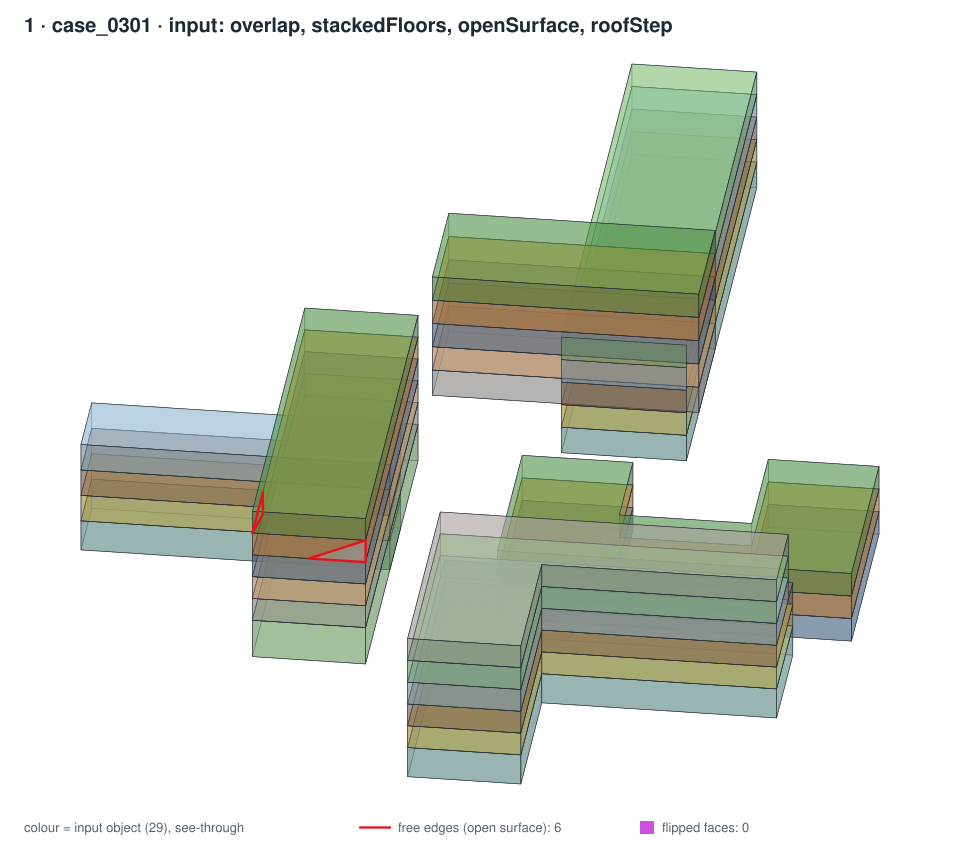
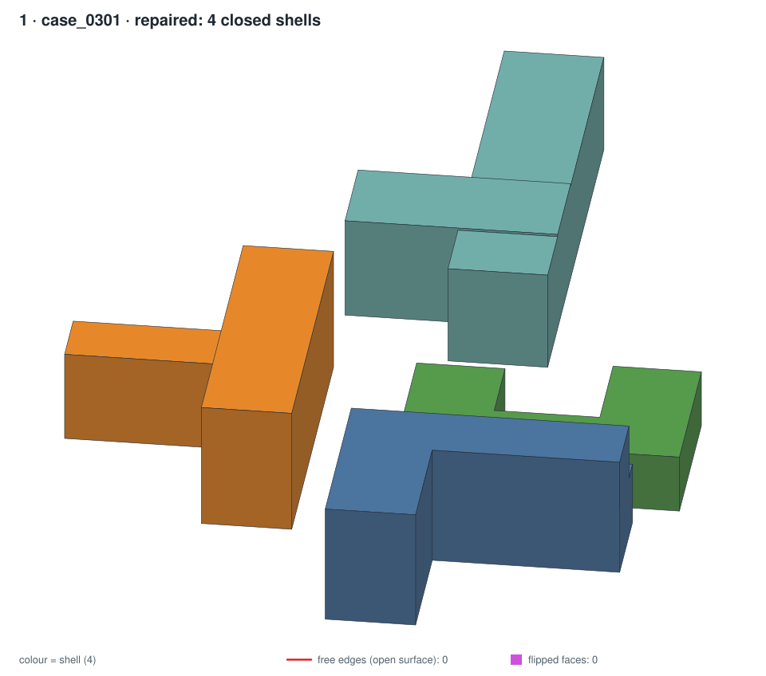
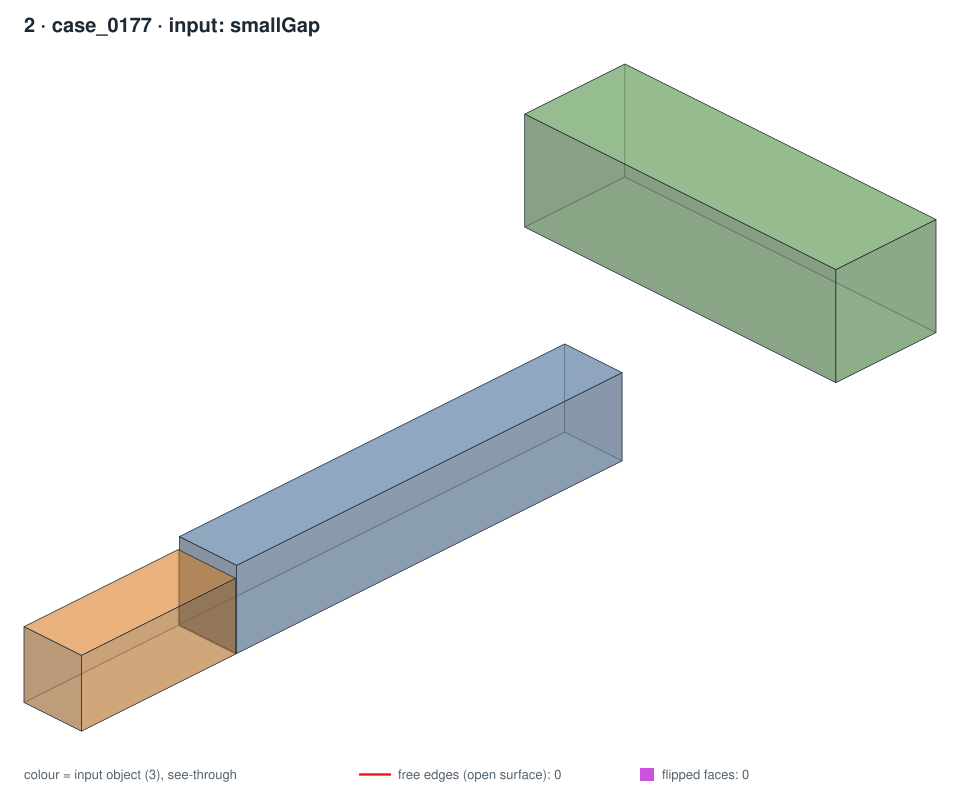
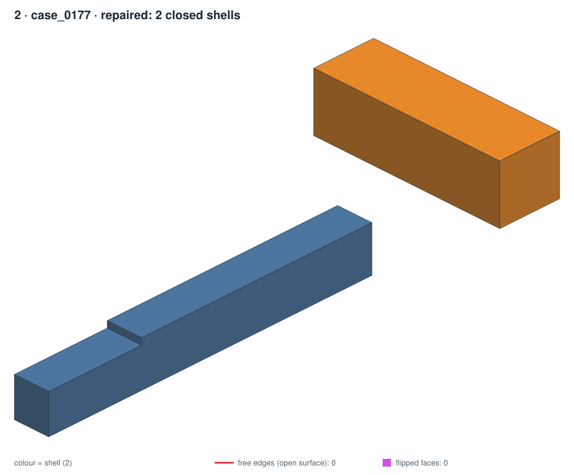
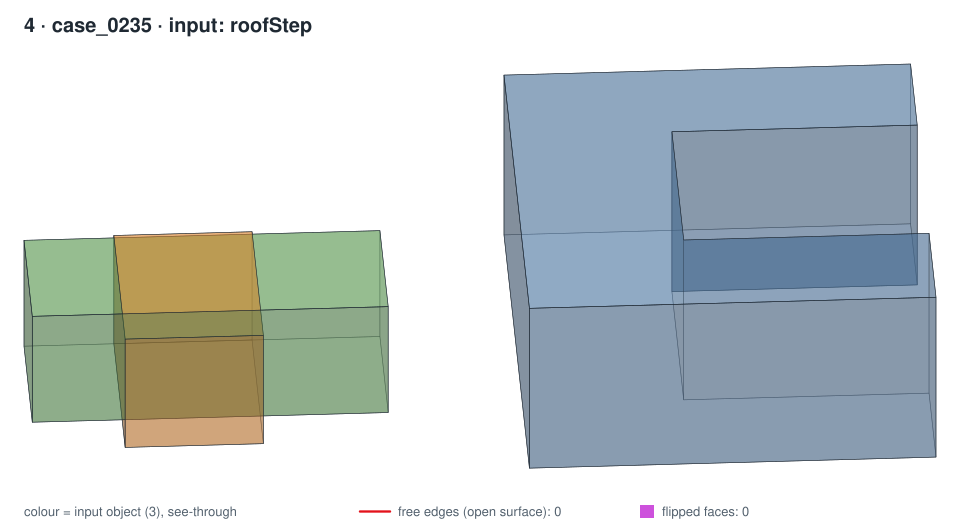

# Massing-to-Wind

**Automatic repair of generative-design building massings into simulation-ready geometry for wind (CFD) analysis**

[](https://github.com/eggzec/massing-to-wind/actions/workflows/ci.yml)
[](https://github.com/eggzec/massing-to-wind/tags)

[](LICENSE)
[](https://dotnet.microsoft.com/download/dotnet/8.0)

`m2w` is a pure C# (.NET 8) engine that repairs the building massings produced by generative design tools —
stacked floor boxes, overlapping blocks, tiny gaps, slivers, open or flipped surfaces, floating blocks, map
coordinates — into closed, non-intersecting shells that wind (CFD) meshers accept. It reads OBJ and writes the
repaired OBJ plus a report of every change it made. An independent checker grades the output: 311/311 visible cases
and 930/930 unseen cases pass, and the output is byte-identical on Linux and Windows.

## The problem

Generative design tools produce hundreds of massing options per site, built to look right on screen: stacked
floor boxes, overlapping blocks, touching walls, tiny gaps, slivers, open or flipped surfaces, blocks floating
above the ground, large map coordinates. Wind (CFD) meshers need clean, closed, non-intersecting shells.
Geometry preparation is widely reported as one of the main bottlenecks of the CFD workflow, so pedestrian wind
comfort is usually checked late, when changing the massing is expensive.

## The approach

1. A seeded generator reproduces how generative tools build massings, then injects the faults they cause,
   and records the correct answer for each case.
2. A repair engine fixes the faults without seeing the answers.
3. An independent checker grades every repaired case: watertightness, orientation, topology, gaps, edge
   length, volume, footprint and height.

See `AGREEMENT.md` for the file formats and `MILESTONES.md` for the plan. Design choices are in `DECISIONS.md`
(D-numbers below).

## Before and after

<!-- Images and captions from docs/images/ (generator). Captions are copied from docs/images/showcase.json. -->

| Before | After |
| --- | --- |
|  |  |
| _1. Stacked floors and overlapping blocks (29 input objects, 2 missing faces) become 4 closed shells; a 0.375 m roof step (above minEdge) is kept._ | |
|  |  |
| _2. A 0.2 m gap (below minGap 1 m) is closed, so two blocks become one shell; the block farther away stays separate._ | |
|  |  |
| _3. An inside-out block with 3 missing faces, floating 0.71 m above the ground: faces turned outward, holes closed, set on the ground._ | |
|  |  |
| _4. Two roofs 0.24 m apart (below minEdge 0.25 m) are flushed to 10.84 m and joined; the taller block stays a shell of its own._ | |

## How it works

The repair engine (`src/M2W.Repair`) reads only `input.obj` and `case.json`. Its output is a 2.5D height field:
one closed shell per connected footprint, each standing on Z = 0.

1. **Shift, weld, deduplicate.** The case origin is subtracted, so the engine works near zero. Each object keeps
   its own vertex list. Within an object, vertices closer than `weld` are merged; degenerate and duplicate faces
   are dropped, and polygons are triangulated. (D-027, D-049)
2. **Orientation and hole closing.** Orientation is spread across shared edges, and inside-out pieces are
   reversed. T-junctions on open edges are split, and the remaining open loops are filled; nested loops are filled
   as one polygon with holes. (D-049)
3. **Ground snap.** A block whose lowest point is within `groundSnap` of Z = 0 is moved onto the ground as a whole.
   Blocks further up are left where they are, because they may stand on another block. (D-049)
4. **Object split.** An object holding several separate closed solids is repaired as one part per solid, so one
   object or one object per part gives the same result. This runs on each object right after the shift. (D-041)
5. **Height-field union.** The horizontal faces of all parts become tagged outlines in plan. These are overlaid,
   and each plan face takes the highest roof over it, filled down to the ground. This merges stacked floors,
   overlaps and touching walls in one pass. (D-029, D-040)
6. **Gap closing.** At each roof level, gaps narrower than `minGap` between separate parts are bridged. Facing
   walls get a strip and corners get a small fillet. Each bridge is filled up to the lower of the two roofs.
   (D-032, D-036)
7. **Roof flush.** Neighbouring roofs whose heights differ by less than `minEdge` are raised to the higher one.
   (D-030, D-037)
8. **Short-edge rules and snapping.** Regions thinner than `minEdge` are raised to the roof beside them, and short
   jogs, bumps and notches are removed by the least change. Then the baked level outlines are snapped, so no two
   points are closer than `minEdge`. This step and gap closing are repeated until the plan stops changing.
   (D-033, D-034, D-036)
9. **Rebuild closed shells.** For each footprint the engine builds a ground face, roofs (triangulated to maximise
   the smallest angle) and walls, with every column split at the heights that meet it. The shells are closed by
   construction and written in an order that depends only on their geometry. (D-029, D-031, D-047)

Steps 6 and 8 run inside the union and step 7 after them. Every operation is listed in `report.json` with counts and
plan boxes (D-042). When something cannot be fully repaired, the status is `partial` with a located warning, never
a silent success.

## Results

**Visible cases** (`cases/`, from `out/summary.json` after `scripts/validate.ps1` on `main`): **311/311 pass**.
A combined case counts once under each of its faults.

| Fault | Passed / total |
| --- | --- |
| clean (controls, must pass with zero repair) | 10/10 |
| duplicateVertices | 31/31 |
| farCoordinates | 30/30 |
| flippedFaces | 29/29 |
| floatingBlock | 29/29 |
| openSurface | 29/29 |
| overlap | 29/29 |
| roofStep | 29/29 |
| shortEdge | 29/29 |
| sliver | 29/29 |
| smallGap | 30/30 |
| stackedFloors | 30/30 |
| sunkBlock | 30/30 |
| touchingWalls | 29/29 |

**Unseen seeds** (the current generator run with `m2w generate --seed 777`, `2024` and `99991` into a folder
outside the repository; the solver never saw these cases while it was being written): **930/930 pass**
(310/310 per seed).

**Owner's private results** (run by the owner; the material is not shared):
_The hidden set stays private on purpose: its cases and seed were never seen by the repair engine while it was
being written, so it measures overfitting to the visible cases. Publishing it would end that. The benchmark
geometry is third-party material and is not ours to share. Only totals are reported._
- Private hidden set: **310/310 pass**. Worst tolerance use: volume 6.6 %, footprint 11.7 %, height 6.2 %.
- Owner benchmarks on geometry the generator did not make: the cases with exact answers all pass with zero
  error. A real district comes out valid in about 2 s.

A `sliver` pass says the shell is valid and the right size. It does not say that thin triangles are gone, because
minimum angle is not graded in v0.1 (see Limitations).

## Runtime

Synthetic district of about 500 blocks: terraced rows with shared walls, gaps of 0.1–0.9 m, set-back tiers and
raised slabs. Measured in-process, Release build, on the development machine, median of 7 runs after warm-up:

| District | One object per part | One object |
| --- | --- | --- |
| 503 parts, on the axes, heights to 0.1 m | 0.61 s | 0.62 s |
| 510 parts, city blocks turned up to 8°, heights to 1 cm | 0.79 s | 0.76 s |

Single runs ranged from 0.4 to 1.8 s. 2,020 parts take about 3–3.5 s. Earlier measurements and the profile behind
them are in D-040. The test limit is 15 s (`Step9ScaleTests`, 3 × the 5 s target).

## Quick start

Requires the .NET 8 SDK, 8.0.400 or later (pinned in `global.json`). No other tools are needed, except Git Bash on
Windows for the lock check inside validate.

Linux and macOS (bash), or Git Bash on Windows:

```bash
scripts/setup.sh          # adds all projects to M2W.sln and builds
scripts/validate.sh       # build, test, run all cases, check locks, print out/summary.json
dotnet run --project src/M2W.Cli -- check cases/_example/case_0007
```

Windows (PowerShell):

```powershell
powershell -ExecutionPolicy Bypass -File scripts\setup.ps1
powershell -ExecutionPolicy Bypass -File scripts\validate.ps1
dotnet run --project src/M2W.Cli -- check cases/_example/case_0007
```

The last line grades the example case against its expected answer. It reads `out/case_0007/repaired.obj`, which
`validate` writes, and writes `out/case_0007/result.json`. Other commands (each writes to `<out>/<caseId>/`):

```bash
dotnet run --project src/M2W.Cli -- repair   cases/case_0101 --out out   # repair one case: repaired.obj, report.json
dotnet run --project src/M2W.Cli -- check    cases/case_0101 --out out   # grade it: result.json
dotnet run --project src/M2W.Cli -- run-all  cases --out out             # repair and grade every case, summary.json
dotnet run --project src/M2W.Cli -- generate ../my-cases --seed 777      # a new set of cases outside the repo
```

## Limitations

The output is a 2.5D height field, so a few things are not represented:
- **Canopies and overhangs** are filled down to the ground. The status is `partial`, with the region located.
- **Sloped roofs** are ignored. The status is `partial`.
- **Thin triangles** are counted in the warnings but not removed. Minimum angle is not graded in v0.1.
- **Roof flushing** adds a little volume, and the least-change jog rule can move the other wall.
- **Input order:** object order does not change the output, with two exceptions far below the tolerances: points
  of different objects within `weld` of each other keep the position of the one met first, and ties between equally
  good roof triangulations depend on order. Rare: found in 4 of 930 unseen cases with two shuffles each, all still
  passing; planned for v0.2.

Details, with D-numbers, are in [KNOWN_LIMITATIONS.md](KNOWN_LIMITATIONS.md).

## Roadmap

**v0.2:**
- Sloped roofs, still as a height field (piecewise planar roofs).
- Overhangs and canopies (needs a 3D union).
- Minimum-angle grading and refinement (D-025, D-035).
- A validity-only grading mode for real data without `expected.json`.

**Later:**
1. External validation: OpenFOAM `surfaceCheck`, `snappyHexMesh` and `checkMesh` on repaired output.
2. Rhino/Grasshopper component wrapping the engine.
3. Batch repair of many options on AWS (Amazon Web Services): one case per job.
4. Fast wind-comfort surrogate model trained on the repaired, simulated options.

## How this was built

v0.1 was built in five days (2026-11-18 to 2026-11-22) by three AI coding agents (Claude Code), each with its own role, branch and folder,
overseen by a human owner who set direction, answered questions and held the milestone gates. The working files
are kept in the repository on purpose, as a record of how the project was run:

| File | What it is |
| --- | --- |
| [`AGREEMENT.md`](AGREEMENT.md) | The contract between the agents: file formats, faults, tolerances, grading. Locked. |
| [`CLAUDE.md`](CLAUDE.md), [`.claude/agents/`](.claude/agents/) | Rules every agent follows, and one brief per role: generator, checker, solver. |
| [`MILESTONES.md`](MILESTONES.md) | The plan, with acceptance criteria and a gate per milestone. |
| [`PROGRESS.md`](PROGRESS.md) | The day-by-day log of every session, with pass counts. |
| [`DECISIONS.md`](DECISIONS.md) | Every design choice someone could question (the D-numbers cited above). |
| [`OWNER_GUIDE.md`](OWNER_GUIDE.md) | How the owner ran the agents, gates and hidden cases. |
| [`docs/HANDOFF-v0.2.md`](docs/HANDOFF-v0.2.md) | Where v0.2 starts. |

The key rule is separation: the solver reads only `input.obj` and `case.json`, never the expected answers or the
generator and checker code; `scripts/check-locks.sh` fails if an agent edits a locked path. You don't need any of
these files to use the engine; see Quick start.

## License

MIT — see [LICENSE](LICENSE).
