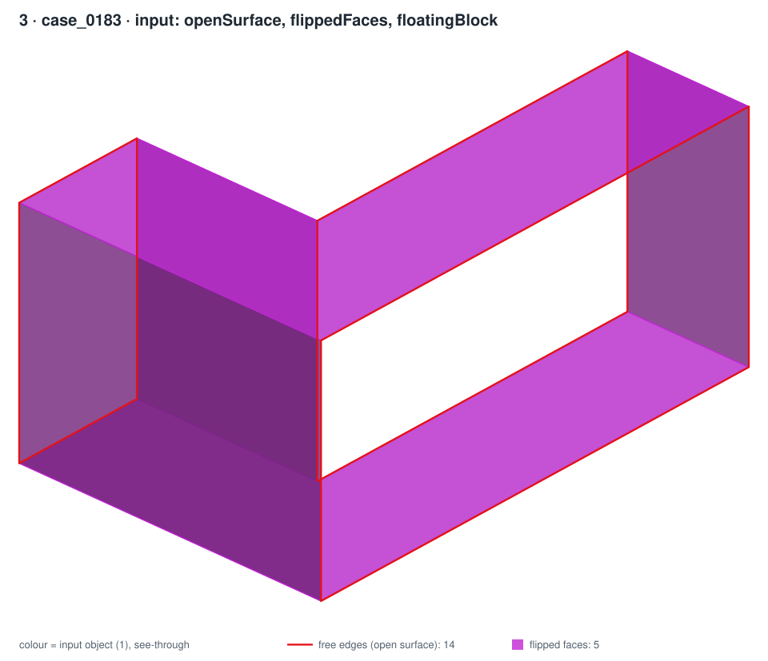
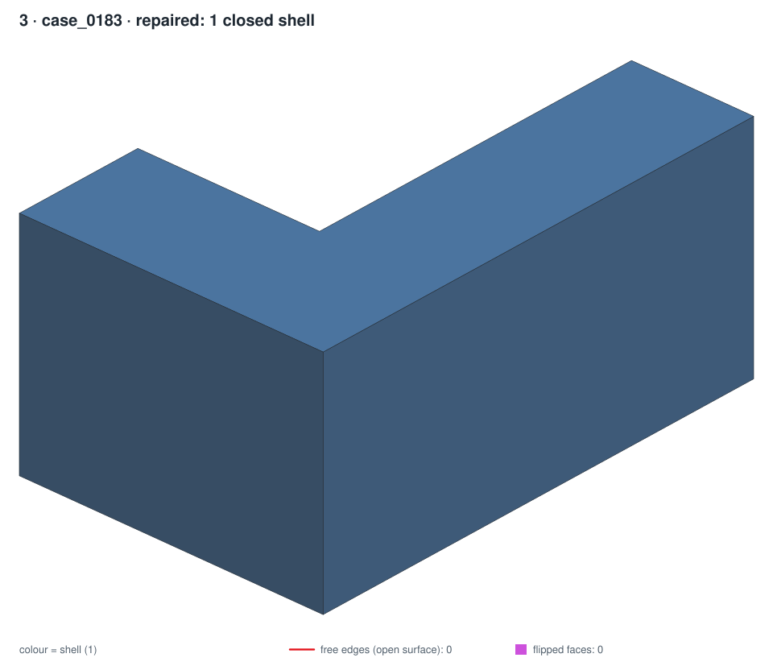
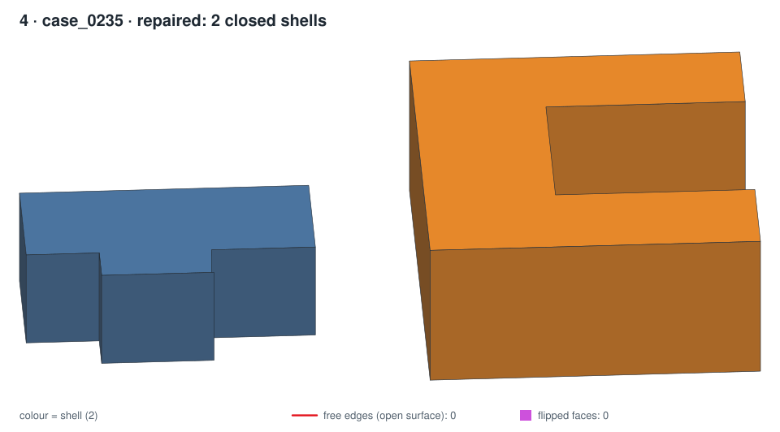

# Massing-to-Wind

**Turn rough building massings into clean, closed geometry for wind (CFD) simulation, automatically**

[](https://github.com/eggzec/massing-to-wind/actions/workflows/ci.yml)
[](https://github.com/eggzec/massing-to-wind/tags)

[](LICENSE)
[](https://dotnet.microsoft.com/download/dotnet/8.0)

Massings from generative design tools look right on screen, but they are often stacks of floor boxes that overlap,
leave small gaps, miss faces or float above the ground. Wind simulation needs closed solids that do not intersect,
so someone usually has to clean up every option by hand.

Massing-to-Wind (`m2w`) does that cleanup. Give it an OBJ file and it writes a repaired OBJ, plus a report of every
change it made. A district of about 500 blocks typically takes under a second.

| Before | After |
| --- | --- |
|  |  |
| 29 separate floor boxes, overlapping, with 2 faces missing | 4 closed buildings, ready to mesh |

**Contents:** [What it repairs](#what-it-repairs) · [Quick start](#quick-start) ·
[Repair your own model](#repair-your-own-model) · [How it works](#how-it-works) · [Limitations](#limitations) ·
[Validation](#validation) · [Roadmap](#roadmap)

## What it repairs

| Problem in the massing | What `m2w` does |
| --- | --- |
| Buildings made of stacked floors | Merges the floors into one solid |
| Overlapping blocks, touching walls | Joins them and removes the walls inside |
| Small gaps between blocks | Bridges gaps narrower than `minGap` (1 m) |
| Missing faces, holes | Closes them |
| Flipped faces, inside-out blocks | Turns every face outward |
| Blocks floating above or sunk below the ground | Moves blocks within `groundSnap` (0.5 m) onto the ground |
| Tiny steps between neighbouring roofs | Levels steps smaller than `minEdge` (0.25 m) to the higher roof |
| Very short edges, jogs, notches and thin strips | Removes detail smaller than `minEdge` |
| Duplicate vertices and faces | Merges or removes them |
| Large map coordinates | Moves the model near the origin and records the shift |

The distances in brackets are defaults, and [you can change them](#settings).

In the output, each building (or group of joined buildings) is one shell. Every shell is watertight, made of
triangles, faces outward, does not intersect itself and has a closed base at ground level (Z = 0). If `m2w` cannot
fully repair something, it says so and tells you where (see [Read the result](#read-the-result)).

### More examples

In the "before" images, red lines are open edges and purple faces point the wrong way.

**A 0.2 m gap is closed.** The two near blocks become one solid; the block farther away stays separate.

| Before | After |
| --- | --- |
|  |  |

**An inside-out block is made solid.** It has 3 missing faces and floats 0.71 m above the ground. The faces are
turned outward, the holes closed and the block set on the ground (with `groundSnap` set to 1 m for this model).

| Before | After |
| --- | --- |
|  |  |

**Two roofs 0.24 m apart are levelled.** The two blocks are joined into one solid; the taller building stays
separate.

| Before | After |
| --- | --- |
|  |  |

## Quick start

You need the [.NET 8 SDK](https://dotnet.microsoft.com/download/dotnet/8.0) (8.0.400 or later). The same commands
work on Windows, Linux and macOS.

```bash
git clone https://github.com/eggzec/massing-to-wind.git
cd massing-to-wind
bash scripts/install-tool.sh
```

In Windows PowerShell, use this as the last line instead:

```powershell
powershell -ExecutionPolicy Bypass -File scripts\install-tool.ps1
```

This installs the command `m2w` for your user account. It works from any folder:

```bash
m2w repair cases/_example/case_0007
```

The example is a tower made of six stacked floor boxes, 0.3 m away from a second block, in map coordinates. `m2w`
turns these 7 boxes (42 faces) into one closed solid of 12 triangles and writes two files to `out/case_0007/`:

| File | What it is |
| --- | --- |
| `repaired.obj` | The clean geometry. Open it in any OBJ viewer, such as Rhino, Blender or ParaView |
| `report.json` | Every change made, with counts and locations |

You can also draw a quick picture without a 3D viewer:

```bash
m2w render out/case_0007/repaired.obj --out repaired.svg
```

## Repair your own model

The model must be an OBJ file in metres with Z up. Faces can be triangles or flat polygons.

```bash
m2w repair my-site.obj
```

The result is in `out/my-site/`; `--out DIR` chooses another folder. If the model uses map coordinates, give a point
near the site as `--origin`. It is subtracted from the model, so the output is in local coordinates:

```bash
m2w repair my-site.obj --origin 530000,180000,0 --out results
```

### Settings

Options change how much the repair alters. Any setting you leave out keeps its default.

```bash
m2w repair my-site.obj --min-gap 0.5 --min-edge 0.2
```

| Option | In `case.json` | Default | Meaning |
| --- | --- | --- | --- |
| `--min-gap` | `minGap` | 1.0 m | Gaps between blocks narrower than this are closed |
| `--min-edge` | `minEdge` | 0.25 m | Edges, jogs and roof steps smaller than this are removed |
| `--ground-snap` | `groundSnap` | 0.5 m | Blocks this close to the ground, above or below, are moved onto it |
| `--weld` | `weld` | 0.001 m | Vertices closer than this become one |
| `--min-angle` | `minAngleDeg` | 5° | Triangles with a smaller angle are counted in the warnings (not removed) |

To keep the settings with the model, put it in a folder as `input.obj` with a `case.json` next to it, and run
`m2w repair my-site` on the folder. `caseId` is the name of the output folder:

```json
{
  "schemaVersion": "0.1",
  "caseId": "my-site",
  "units": "m",
  "origin": [530000, 180000, 0],
  "tolerances": { "minGap": 0.5, "minEdge": 0.2 },
  "files": { "input": "input.obj" }
}
```

`m2w --help` lists all commands, and `m2w repair --help` all options.

### Read the result

`report.json` gives the overall `status`:

| `status` | Meaning | Exit code |
| --- | --- | --- |
| `repaired` | Everything was repaired | 0 |
| `partial` | An output was written, but part of it needs a look; `warnings` say what and where | 1 |
| `failed` | No closed solid could be built | 1 |

If the input cannot be read, the exit code is 2. The report also lists every operation. For example, a closed gap
looks like this:

```json
{
  "op": "closeGap",
  "pair": ["B01", "B02"],
  "width_m": 0.3,
  "fillHeight_m": 18,
  "minGap_m": 1,
  "bbox_m": [20, 0, 20.3, 10]
}
```

`bbox_m` is the place in plan: min X, min Y, max X, max Y.

The same input always gives the same `repaired.obj`, on Linux and Windows. All file formats are described in
[AGREEMENT.md](AGREEMENT.md).

### Use it from C#

The engine is pure C# with no native dependencies. Reference `src/M2W.Repair` from your project:

```csharp
using M2W.Geometry;
using M2W.Geometry.Models;
using M2W.Geometry.Stages;
using M2W.Repair;

var outcome = new MassingRepairer().Repair(new RepairRequest
{
    Case = CaseSpec.Load("my-site/case.json"),
    Input = ObjReader.ReadFile("my-site/input.obj"),
});

Console.WriteLine($"{outcome.Report.Status}: {outcome.Report.ShellCount} shell(s)");
if (outcome.Repaired is not null)
    ObjWriter.WriteFile(outcome.Repaired, "repaired.obj");
```

## How it works

Instead of patching the broken mesh face by face, `m2w` rebuilds it. It cleans each block, looks at the site from
above, finds the roof height at every point and builds new solids from that plan.

1. **Clean each block.** Move it near the origin, merge duplicate vertices, turn faces outward, close holes and set
   the block on the ground.
2. **Merge everything in plan.** Overlay all the blocks and keep the highest roof at each place. Stacked floors,
   overlaps and touching walls disappear in this one step.
3. **Remove detail too small to mesh.** Close small gaps, level tiny roof steps and remove short edges.
4. **Rebuild closed solids.** Build a base, walls and roofs for each footprint. The solids are closed by
   construction.

<details>
<summary><b>The full pipeline, with links to the design decisions</b></summary>

The engine is in `src/M2W.Repair`. D-numbers refer to [DECISIONS.md](DECISIONS.md).

1. **Shift, weld, deduplicate.** The case origin is subtracted, so the engine works near zero. Each object keeps
   its own vertex list. Within an object, vertices closer than `weld` are merged; degenerate and duplicate faces
   are dropped, and polygons are triangulated. (D-027, D-049)
2. **Orientation and hole closing.** Orientation is spread across shared edges, and inside-out pieces are
   reversed. T-junctions on open edges are split, and the remaining open loops are filled; nested loops are filled
   as one polygon with holes. (D-049)
3. **Ground snap.** A block whose lowest point is within `groundSnap` of Z = 0 is moved onto the ground as a whole.
   Blocks further up are left where they are, because they may stand on another block. (D-049)
4. **Object split.** An object holding several separate closed solids is repaired as one part per solid, so one
   object or one object per part gives the same result. This runs on each object right after the shift. (D-041)
5. **Height-field union.** The horizontal faces of all parts become tagged outlines in plan. These are overlaid,
   and each plan face takes the highest roof over it, filled down to the ground. This merges stacked floors,
   overlaps and touching walls in one pass. (D-029, D-040)
6. **Gap closing.** At each roof level, gaps narrower than `minGap` between separate parts are bridged. Facing
   walls get a strip and corners get a small fillet. Each bridge is filled up to the lower of the two roofs.
   (D-032, D-036)
7. **Roof flush.** Neighbouring roofs whose heights differ by less than `minEdge` are raised to the higher one.
   (D-030, D-037)
8. **Short-edge rules and snapping.** Regions thinner than `minEdge` are raised to the roof beside them, and short
   jogs, bumps and notches are removed by the least change. Then the baked level outlines are snapped, so no two
   points are closer than `minEdge`. This step and gap closing are repeated until the plan stops changing.
   (D-033, D-034, D-036)
9. **Rebuild closed shells.** For each footprint the engine builds a ground face, roofs (triangulated to maximise
   the smallest angle) and walls, with every column split at the heights that meet it. The shells are written in an
   order that depends only on their geometry. (D-029, D-031, D-047)

Steps 6 and 8 run inside the union and step 7 after them. Every operation is listed in `report.json` with counts
and plan boxes (D-042).

</details>

## Limitations

Version 0.1 is made for block massings with flat roofs. Check these before you use it:

- **Sloped roofs are not supported.** Sloped faces are ignored and the status is `partial`.
- **Canopies and overhangs become solid.** The space under them is filled down to the ground and the status is
  `partial`.
- **Narrow inlets and courtyards inside one block stay open.** Only gaps between separate blocks are closed.
- **Thin triangles can remain**, for example on long low walls. They are counted in the warnings.
- **Volumes can change slightly** where small roof steps are levelled or short jogs removed.
- **Not yet tested in a wind mesher.** The geometry is checked as described under [Validation](#validation);
  meshing it in OpenFOAM is on the roadmap.
- **Object order** does not change the output, apart from rare differences far below the tolerances.

[KNOWN_LIMITATIONS.md](KNOWN_LIMITATIONS.md) has the details.

## Performance

Measured on a synthetic district with terraced rows, small gaps, set-back tiers and raised slabs:

| District | One object per block | All in one object |
| --- | --- | --- |
| 503 blocks, aligned to the axes | 0.61 s | 0.62 s |
| 510 blocks, turned up to 8° | 0.79 s | 0.76 s |

About 2,000 blocks take 3–3.5 s. These are in-process times in a Release build on the development machine, median of
7 runs after warm-up. Single runs of the 500-block districts ranged from 0.4 to 1.8 s.

## Validation

The repair is tested against generated massings with known faults and known correct answers. A separate checker,
which shares no repair code, compares each result with its answer: watertightness, orientation, topology, gaps, edge
length, volume, footprint and height.

| Test set | Passed |
| --- | --- |
| Cases in this repository (`cases/`) | 311/311 |
| Unseen cases, from generator seeds not used during development | 930/930 |
| Private cases, kept by the owner | 310/310 |

The engine also repaired a real district into valid geometry in about 2 s.

<details>
<summary><b>Results by fault, unseen seeds and private cases</b></summary>

**Cases in this repository** (from `out/summary.json` after `scripts/validate`). A combined case counts once under
each of its faults.

| Fault | Passed / total |
| --- | --- |
| clean (controls, must pass with zero repair) | 10/10 |
| duplicateVertices | 31/31 |
| farCoordinates | 30/30 |
| flippedFaces | 29/29 |
| floatingBlock | 29/29 |
| openSurface | 29/29 |
| overlap | 29/29 |
| roofStep | 29/29 |
| shortEdge | 29/29 |
| sliver | 29/29 |
| smallGap | 30/30 |
| stackedFloors | 30/30 |
| sunkBlock | 30/30 |
| touchingWalls | 29/29 |

A `sliver` pass says the shell is valid and the right size. It does not say that thin triangles are gone, because
minimum angle is not graded in v0.1 (see [Limitations](#limitations)).

**Unseen seeds:** the generator run with `m2w generate --seed 777`, `2024` and `99991` into a folder outside the
repository; 310/310 per seed.

**Private cases** (run by the owner): 310/310. Worst tolerance use: volume 6.6 %, footprint 11.7 %, height 6.2 %.
The set stays private so that it measures overfitting to the visible cases. The owner also ran benchmarks on
third-party geometry that the generator did not make and that is not ours to share: the cases with exact answers all
pass with zero error, and a real district comes out valid in about 2 s.

</details>

To run the build, tests and all cases yourself (on Windows this needs Git Bash):

```bash
scripts/validate.sh                                             # Linux, macOS, Git Bash
powershell -ExecutionPolicy Bypass -File scripts\validate.ps1   # Windows PowerShell
```

## Roadmap

**v0.2**
- Sloped roofs.
- Overhangs and canopies.
- Minimum-angle grading and refinement.
- Validity checks for real models that have no known answer.

**Later**
- Validation in OpenFOAM: `surfaceCheck`, `snappyHexMesh` and `checkMesh` on repaired output.
- A Rhino/Grasshopper component.
- Batch repair of many design options in the cloud.
- A fast wind-comfort model trained on the repaired, simulated options.

## About this project

v0.1 was built in five days (2026-11-18 to 2026-11-22) by three AI coding agents (Claude Code) in separate roles,
overseen by a human owner: one generated the test cases, one wrote the checker and one wrote the repair engine,
without seeing the expected answers. The working files are kept as a record; you don't need them to use the engine.

<details>
<summary><b>Project files</b></summary>

| File | What it is |
| --- | --- |
| [`AGREEMENT.md`](AGREEMENT.md) | The contract between the agents: file formats, faults, tolerances, grading. Locked. |
| [`CLAUDE.md`](CLAUDE.md), [`.claude/agents/`](.claude/agents/) | Rules every agent follows, and one brief per role: generator, checker, solver. |
| [`MILESTONES.md`](MILESTONES.md) | The plan, with acceptance criteria and a gate per milestone. |
| [`PROGRESS.md`](PROGRESS.md) | The day-by-day log of every session, with pass counts. |
| [`DECISIONS.md`](DECISIONS.md) | Every design choice someone could question (the D-numbers above). |
| [`OWNER_GUIDE.md`](OWNER_GUIDE.md) | How the owner ran the agents, gates and hidden cases. |
| [`docs/HANDOFF-v0.2.md`](docs/HANDOFF-v0.2.md) | Where v0.2 starts. |

The solver reads only `input.obj` and `case.json`, never the expected answers or the generator and checker code.
`scripts/check-locks.sh` fails if an agent edits a locked path.

</details>

## License

MIT — see [LICENSE](LICENSE).
